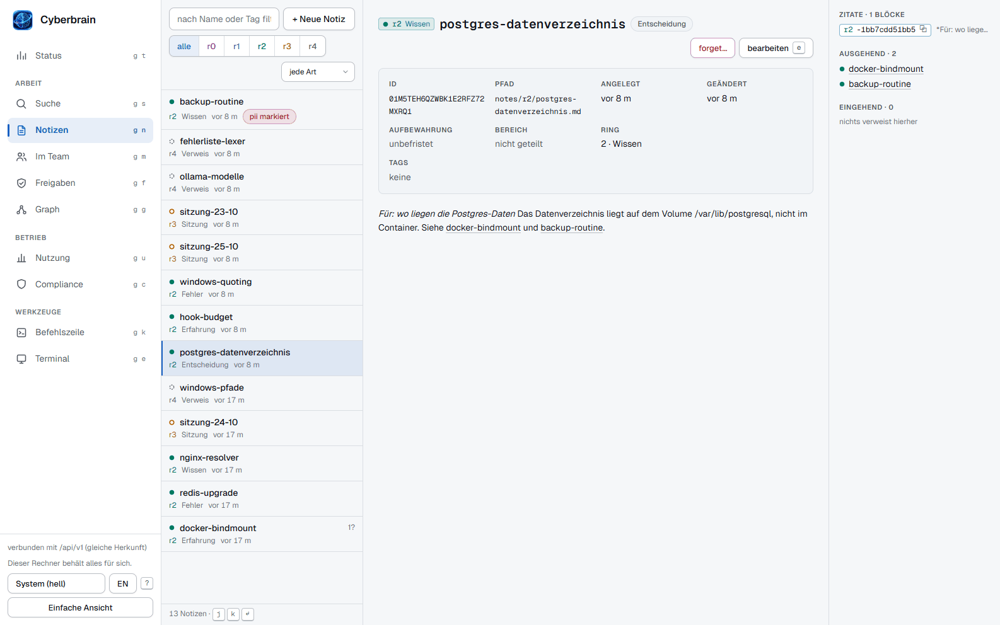
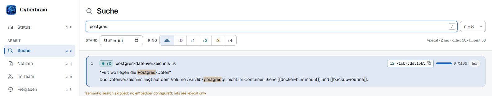
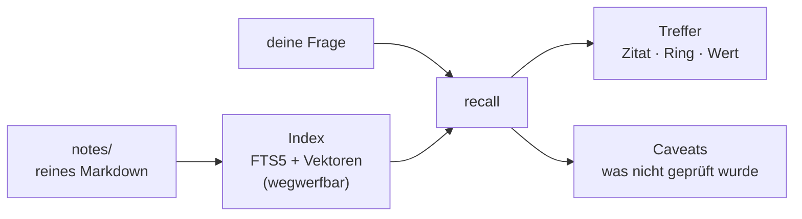
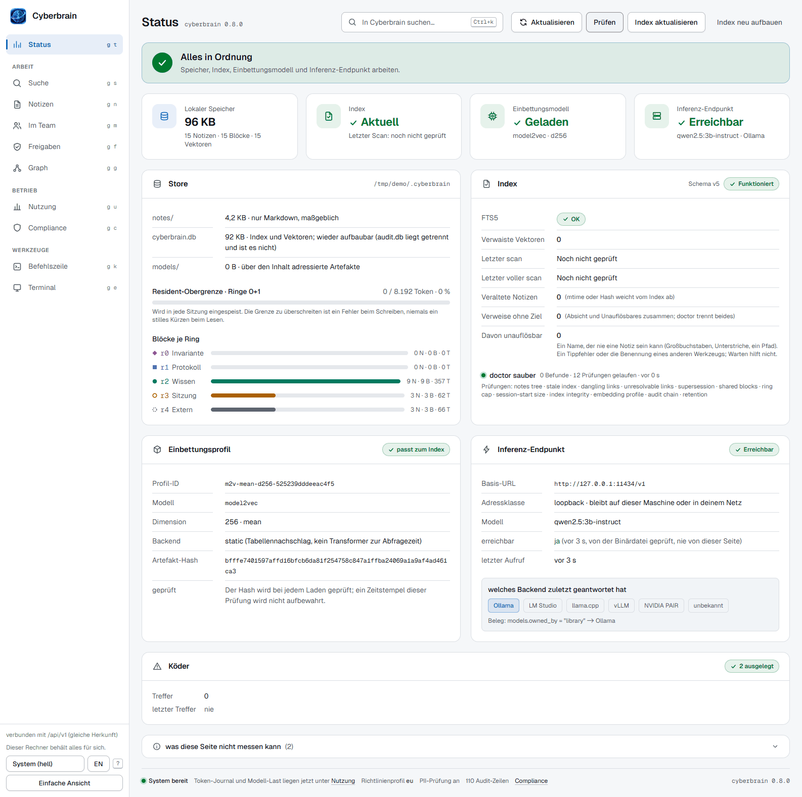
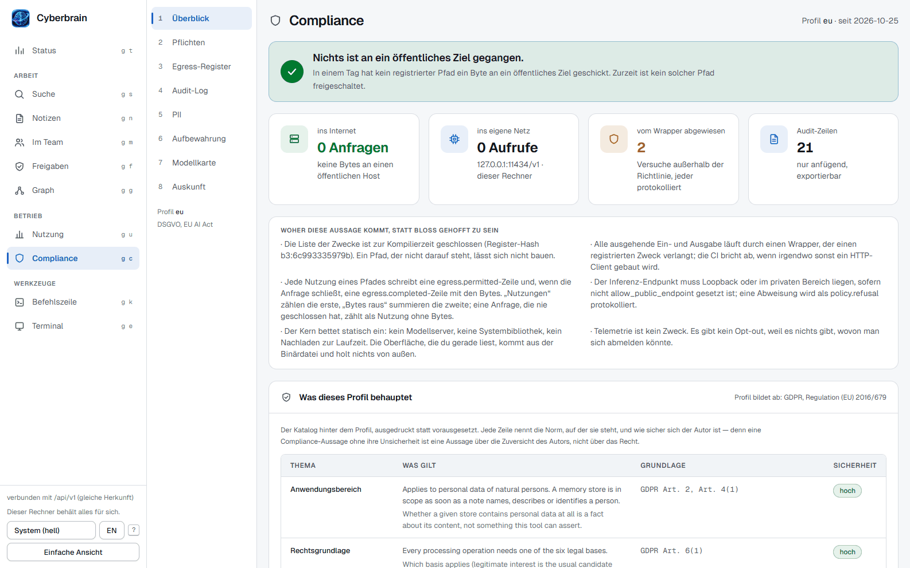
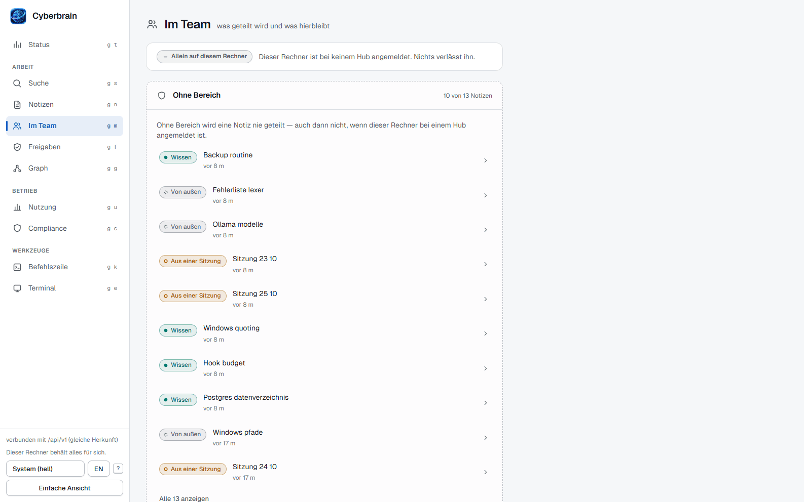
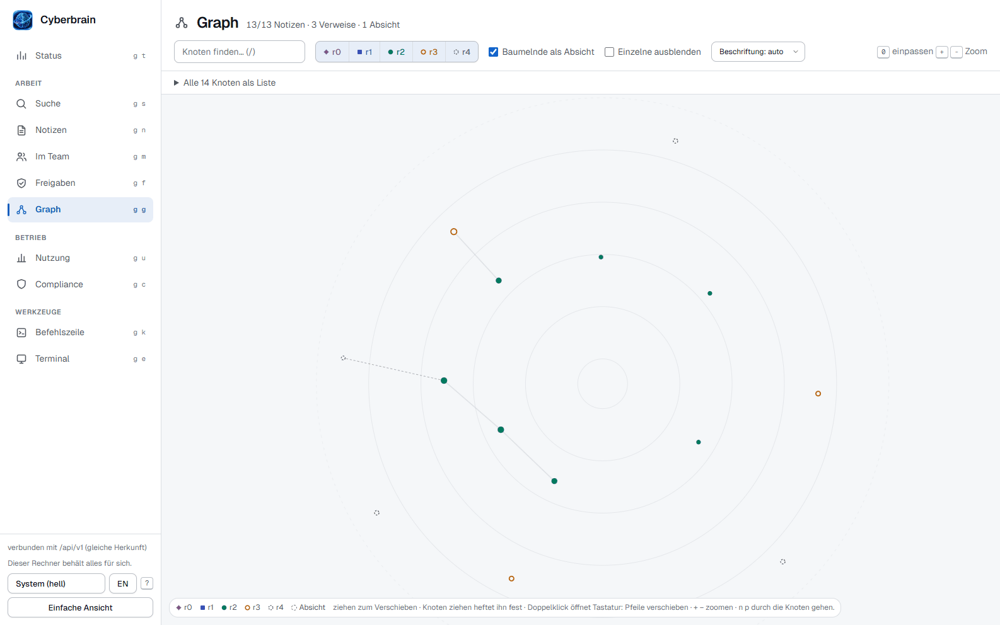

<div align="center">


# Cyberbrain

**Zitiertes, vertrauensgestuftes, lokales Gedächtnis für KI-Coding-Agenten.**

[](https://github.com/bassprofressor-lab/cyberbrain/actions/workflows/ci.yml)
[](https://crates.io/crates/cyberbrain)
[](LICENSE.md)
[](rust-toolchain.toml)
[](#installieren)
[](#für-die-eu-gebaut-abschaltbar)

[English](README.md) · **Deutsch**

[Installieren](#installieren) · [Fünf Minuten](#fünf-minuten) · [Funktionen](#auf-einen-blick) ·
[Wie es arbeitet](#wie-es-arbeitet) · [Was es braucht](#was-es-braucht) ·
[Compliance](#für-die-eu-gebaut-abschaltbar) · [Changelog](CHANGELOG.md) · [Spezifikation](docs/SPEC.md)

</div>

Eine native Binärdatei. Deine Notizen bleiben reines Markdown, lesbar, editierbar, greppbar.
Nichts verlässt den Rechner, außer du sagst es, und jeder Weg, auf dem etwas hinaus könnte,
steht an einer Stelle, die du dir ausdrucken lassen kannst.

<picture>
  <source media="(prefers-color-scheme: dark)" srcset="docs/images/notes-dark.png">
  
</picture>

<sub>Die Weboberfläche, die in der Binärdatei steckt. Die Screenshots stammen aus einem
Demo-Store, die Notizen darin sind erfunden.</sub>

## Neu in 0.8

- **Sprache zu Text, lokal.** `cyberbrain transcribe <datei>` macht aus einer Sprachnotiz
  oder einer Besprechung eine Notiz, über einen whisper.cpp-Server auf deinem eigenen
  Rechner, und die Seite bekommt einen Mikrofon-Knopf zum Diktieren.
  [Mehr dazu unten](#sprache-zu-text).
- **Ein signiertes Audit-Log.** `policy audit-key --init` gibt einem Store einen
  Ed25519-Schlüssel; jede neue Zeile wird signiert, und `verify-export` prüft ein
  exportiertes Bündel gegen den Fingerabdruck, den der Empfänger bekommen hat.
- **Köder.** `cyberbrain canary plant` legt ein Zugangsdatum, das niemand benutzt, in eine
  Notiz. Jede Verwendung außerhalb dieser Notiz wird abgewiesen und als `canary.hit`
  festgehalten.
- **Tokens mit Ablaufdatum**, für MCP-Clients, Zugänge zur Zentraleinheit und Gerätetokens.
- **Ein neues Gesicht.** Eine Weboberfläche im Stil von Windows 11, ein Neon-Gehirn als
  Symbol, und Starter und Installationsprogramm sprechen auf einem deutschen Windows Deutsch.
- Viele Korrekturen beim Abgleich, im Governance-Notbetrieb, beim Schwärzen von PII und bei
  Dateirechten: [CHANGELOG](CHANGELOG.md#080--2026-10-27), samt dem, worauf man beim
  Aktualisieren achten muss.

## Auf einen Blick

| | |
|---|---|
| **Zitiert** | jeder Treffer trägt eine Kennung wie `r2-867ef2a8cd01`, die auf genau den Quellblock zurückführt |
| **Vertrauensgestuft** | Notizen liegen in den Ringen 0 bis 4; bei Widerspruch gewinnt der niedrigere Ring, und der Konflikt wird gemeldet |
| **Lokal zuerst** | Einbettungen werden auf deinem Rechner gerechnet; der Kern macht kein Netzwerk-I/O |
| **Hybride Suche** | SQLite FTS5 für die Wörter und lokale Vektoren für die Bedeutung, zu einer Rangfolge verschmolzen |
| **Ehrliche Ergebnisse** | jede Antwort sagt als Caveat, was *nicht* geprüft wurde |
| **Vier Wege hinein** | Kommandozeile, Agenten-Hooks, MCP-Server, Weboberfläche mit HTTP-API |
| **Zentraleinheit, optional** | ein Rechner sammelt die Nachweise der übrigen ein; Notizen teilen nur, wenn eingeschaltet |
| **Compliance eingebaut** | Ausgangsregister, Löschung, Auskunft, PII-Prüfung, signiertes Audit-Log mit Hashkette |

```console
$ cyberbrain recall 'postgres data directory'
1. r2-867ef2a8cd01  r2  pg18-moves-pgdata  (100% of top)
     # PostgreSQL 18 moves PGDATA
     The official `postgres:18` image puts the data directory at
     `/var/lib/postgresql/18/docker` instead of `/var/lib/postgresql/data` ...
caveat: contradiction check skipped: no inference model is configured
```

Die letzte Zeile ist genauso der Punkt wie der Treffer selbst. Das Werkzeug sagt, was es
**nicht** geprüft hat. Die Seite macht es genauso:

<picture>
  <source media="(prefers-color-scheme: dark)" srcset="docs/images/search-dark.png">
  
</picture>

## Installieren

```console
$ cargo install cyberbrain
$ cyberbrain init
```

Oder eine fertige Binärdatei aus dem [letzten Release](https://github.com/bassprofressor-lab/cyberbrain/releases/latest)
nehmen (Linux x86_64, Windows x86_64, macOS mit Apple-Chip) und gegen die danebenliegende
`SHA256SUMS` nachrechnen:

```console
$ sha256sum -c SHA256SUMS
$ ./cyberbrain-linux-x86_64 init
```

Zur Laufzeit braucht die Binärdatei nichts weiter: kein SQLite aus dem System, kein OpenSSL,
keinen Modellserver, kein node.

### Windows ohne Terminal

Am Release hängt außerdem `cyberbrain-setup-<version>.exe`. Es installiert das
Kommandozeilenwerkzeug und einen kleinen Starter und legt **Cyberbrain** ins Startmenü. Ein
Klick darauf fragt einmal, welches Projekt geöffnet werden soll, startet den Server auf einem
Port, den Windows aussucht, öffnet die Seite und bleibt danach im Infobereich: Rechtsklick
für den Projektordner, ein anderes Projekt, *Mit Windows starten* (von Haus aus aus) oder
Beenden. Wird der Starter beendet, endet auch der Server. Ein zweiter Start bringt kein
zweites Symbol, sondern zeigt die Seite, die schon läuft. Starter und Installationsprogramm
sprechen auf einem deutschen Windows Deutsch, sonst Englisch.

Signiert ist die Datei nicht, SmartScreen warnt deshalb beim ersten Start: Weitere
Informationen, dann Trotzdem ausführen. `C:\Program Files\Cyberbrain` trägt das
Installationsprogramm in den `PATH` der Maschine ein, damit `cyberbrain` auch in einem
frischen Fenster läuft. Das macht ein kleines PowerShell-Skript und nicht NSIS selbst: NSIS
kürzt Zeichenketten ab einer festen Länge, und ein Maschinen-PATH ist regelmäßig länger. Im
Installer gelesen und zurückgeschrieben wäre am Ende still etwas abgeschnitten.

Dasselbe Installationsprogramm richtet mit einem Häkchen bei *Hub service (collector)* auch
[die Zentraleinheit](#im-team-die-zentraleinheit) ein.

<details>
<summary>Ohne Weboberfläche, oder aus einem Checkout</summary>

<br>

Die Oberfläche ist in die Binärdatei kompiliert und liegt im Paket, die normale Installation
braucht deshalb keine node-Toolchain. Wer sie nicht mitschleppen will, lässt sie weg; CLI,
Hooks, MCP-Server und HTTP-API bleiben davon unberührt, und `serve` beantwortet die API und
sagt dazu, dass die Seite nicht mit eingebaut wurde:

```console
$ cargo install cyberbrain --no-default-features
```

Aus einem Checkout ist die Seite nicht verpackt, sondern wird gebaut, also zuerst bauen:

```console
$ git clone https://github.com/bassprofressor-lab/cyberbrain && cd cyberbrain
$ (cd ui && npm ci && npm run build)
$ cargo install --path crates/cyberbrain
```

</details>

## Fünf Minuten

```console
$ cyberbrain init
$ cyberbrain write --ring 2 --kind bug --name pg18-moves-pgdata --body 'was du gelernt hast'
$ cyberbrain scan
$ cyberbrain recall 'was du gelernt hast'
```

Vier Wege hinein, alle aus derselben Binärdatei:

| | |
|---|---|
| `cyberbrain <befehl>` | alles ist von der Kommandozeile aus erreichbar, überall mit `--json` |
| `cyberbrain hook <ereignis>` | sechs Lebenszyklus-Ereignisse des Agenten; an einem Store mit 1.300 Notizen und 105.000 Audit-Zeilen ein p99 von 7 bis 9 ms inklusive Prozessstart, bei einem Budget von 15 ms (`session-start`, der die Ringe 0 und 1 übergibt: 17 ms bei 150 ms) |
| `cyberbrain mcp` | Model Context Protocol über stdio, für jeden Client, der es spricht |
| `cyberbrain serve` | Weboberfläche und HTTP-API, auf Loopback, ohne Anmeldung, weil nichts davon den Rechner verlässt; unter Linux kommt nur das eigene Konto (und root) hinein |

`cyberbrain install` schaltet die ersten beiden ein, ohne dass jemand fremdes JSON bearbeitet:
es schreibt die Hooks in die Claude-Code-Einstellungen dieses Projekts und einen MCP-Eintrag in
die Desktop-Clients, die es findet, legt die vorherige Datei daneben, und `--undo` nimmt alles
wieder heraus. Es schreibt jede gefundene Claude-Desktop-Installation statt nur den
dokumentierten Pfad, denn unter Windows sind das nicht dieselbe Datei, und die falsche
scheitert lautlos. Ein gleichnamiger MCP-Eintrag, der nicht cyberbrain startet, wird als
`not-ours` gemeldet und in Ruhe gelassen.

Die Seite hat eine eigene Befehlszeile, damit `find`, `export` und alles andere ohne
Bildschirm nicht bedeuten, dass man in ein Terminal wechselt. Sie startet dasselbe Binary,
das die Seite ausliefert, gegen deren Store, und gibt Ausgabe, Fehlerausgabe und
Rückgabewert unverändert zurück.

`cyberbrain serve --terminal` setzt ein echtes Terminal in die Seite: eine Shell, `ssh`, ein
Agent, im Verzeichnis des Projekts. Es ist aus, solange man es nicht verlangt, es braucht
einen Token, den die Adresse im Fragment trägt, und es weist jede Anfrage von einer anderen
Herkunft ab. Das Ausgangsregister führt es als den einen Weg, den dieses Programm nicht
vermittelt. Ein Register, das ihn verschwiege, während `ssh` einen Tastendruck weit weg ist,
wäre falsch.

Die Ringe 0 und 1 gehören dem Betreiber, und `cyberbrain propose` ist der Weg, auf dem alle
anderen etwas dafür anbieten: die Notiz landet in `proposals/`, außerhalb des Notizbaums,
wird nicht indiziert und ist über `recall` nicht auffindbar. Eine unfreigegebene Invariante,
die ein Agent findet, ist eine Invariante, der niemand zugestimmt hat. Jemand anderes als der
Vorschlagende gibt sie mit `cyberbrain review <name> --accept` frei, die Seite zeigt den
Zeilenvergleich, wenn ein Vorschlag eine bestehende Notiz ändert, und das Audit-Log nennt
beide.

## Wie es arbeitet



Die Notizen sind die Wahrheit und bleiben deine: eine Markdown-Datei je Notiz, im Repository,
lesbar auch ohne dieses Werkzeug. Der Index ist abgeleitet und darf jederzeit gelöscht werden,
`cyberbrain scan` baut ihn neu. Gesucht wird lexikalisch und semantisch zugleich, SQLite FTS5
für die Wörter und ein flacher Kosinus-Durchlauf über lokale Einbettungen für die Bedeutung,
zu einer Rangfolge verschmolzen. `recall --stand <datum>` sucht im Store, wie er an diesem
Tag aussah.

### Drei Eigenschaften, die ein Gedächtnis vertrauenswürdig halten

**Zitiert.** Jede gefundene Aussage trägt eine Kennung, die auf genau den Quellblock
zurückführt. `cyberbrain recall --id r2-867ef2a8cd01` klappt ihn auf. Eine Antwort ohne Zitat
ist ein Fehler, kein schlechteres Ergebnis.

**Vertrauensgestuft.** Notizen liegen in nummerierten Ringen. Ring 0 hält die Invarianten des
Betreibers und überstimmt alles, Ring 4 ist ungeprüftes Material. Ring 0 und 1 werden in jede
Sitzung eingespeist, mit Obergrenze, damit das bezahlbar bleibt. Widersprechen sich zwei
Blöcke, gewinnt der niedrigere Ring, und der Konflikt wird gemeldet statt still aufgelöst.

**Lokal zuerst.** Die Einbettungen werden auf deinem Rechner gerechnet. Der Kern macht
überhaupt kein Netzwerk-I/O. Inferenz ist optional und läuft gegen jeden OpenAI-kompatiblen
Endpunkt, also Ollama, LM Studio, llama.cpp, oder NVIDIA PAIR, das die Arbeit über eine
RTX-Maschine, einen DGX Spark und einen Apple M4 Mac verteilt. Dieser Endpunkt darf auf einer
anderen Maschine im eigenen Netz liegen, eine Maschine mit Grafikkarte kann damit ein ganzes
Team bedienen: [`docs/SHARED-INFERENCE.md`](docs/SHARED-INFERENCE.md).

### Sprache zu Text

`cyberbrain transcribe <datei>` schickt eine Aufnahme an einen
[whisper.cpp](https://github.com/ggml-org/whisper.cpp)-Server auf deinem eigenen Rechner
(`whisper-server --convert`) und schreibt den Text so, wie `write` schreibt: PII-Prüfung,
Audit-Zeile, Index. Von Haus aus in Ring 3, mit dem Tag `transcript`. `--segments` behält
jeden Redeabschnitt mit seiner Zeit in der Aufnahme, `--print` zeigt den Text nur an. In der
Seite setzt ein Mikrofon-Knopf neben dem Suchfeld und im Notiz-Editor den diktierten Text ins
Feld; gespeichert wird erst, wenn du speicherst.

Aus ist es, bis du den Server nennst, und es gilt dieselbe Regel wie für die Inferenz:
Loopback oder privater Bereich, sofern `[inference]` es nicht ausdrücklich erlaubt, jeder
Aufruf im Audit-Log. Die Sprache ist von Haus aus Deutsch; `language` nimmt jeden
whisper-Code oder `auto`.

```toml
# cyberbrain.toml
[transcription]
base_url = "http://127.0.0.1:8178"
```

Kein C++ in diesem Build: das Modell läuft in einem eigenen Prozess, so wie die Einbettungen
in Ollama.

## Im Team: die Zentraleinheit

Die Zentraleinheit (Hub) ist der eine Rechner im Team, der die Nachweise der übrigen
einsammelt. Unter Windows richtet das Installationsprogramm sie mit einem Häkchen ein: es
trägt einen Dienst ein, öffnet den Port und legt einen Ordner für die Lizenzdatei an. Auf den
Arbeitsplätzen nimmt *Connect to the company hub…* im Infobereich die Einladungsdatei
entgegen, die sie bekommen haben. Die Zentraleinheit hat eine Seite unter
`http://localhost:7788/` für Lizenz, Plätze, Personen, Geräte-Einladungen und welche
Maschinen melden. Der erste Aufruf auf ihrem eigenen Rechner setzt das Verwalterkennwort (ein
Standardkennwort gibt es nicht), danach geht sie von jedem Schreibtisch aus auf, über HTTPS.

Von Haus aus nimmt die Zentraleinheit Nachweiszeilen und sonst nichts: eine Zeile sagt, dass
eine Notiz geschrieben wurde, nie was darin stand. Wer dieselbe Übergabenotiz auf vier
Schreibtischen haben will, kann das Teilen einschalten, dann hält die Zentraleinheit auch
den Text der Notizen, die einen `bereich` tragen. Nie die Ringe 0 und 1, nur für Geräte mit
einer Freigabe für diesen Bereich, und erst wenn eine zweite Person diese Freigabe
gegengezeichnet hat, damit wer die Zentraleinheit betreibt nicht eine Abteilung auf einen
eigenen Rechner leiten kann.

Zugänge und Gerätetokens können ein Enddatum tragen (`--expires`). Die Zentraleinheit kann,
was eine Person braucht (wartende Gegenzeichnungen, eine auslaufende Lizenz, seit 48 Stunden
stille Geräte, ein bald ablaufendes Token), an einen Webhook schicken, den ihr Verwalter
festlegt; das ist aus, bis eine Adresse eingetragen ist. Was davon auf deinem Rechner an ist,
sagt dir `cyberbrain policy egress`, ohne jemanden fragen zu müssen. Das ganze Bild steht in
[`docs/HUB.md`](docs/HUB.md).

## Was es braucht

Einen Laptop. Es gibt hier kein großes Modell zu betreiben: die semantische Suche benutzt
**statische Einbettungen**, also ein Nachschlagen in einer Tabelle und einen Mittelwert statt
eines Vorwärtslaufs durch ein Netz. Deshalb reicht ein CPU-Kern, und deshalb ist die Datei auf
der Platte größer als die Arbeit, die sie macht: was da Platz braucht, ist Wortschatz, nicht
Rechenleistung.

| | ohne Modell | mit Einbettungsmodell |
|---|---|---|
| eine Suche | 10 ms | 2,3 s, das meiste davon Modell laden |
| Arbeitsspeicher | 14 MB | 1,55 GB Spitze, während die Suche läuft |
| Index komplett neu | 0,7 s | 4,0 s |
| auf der Platte | — | 507 MB für das Modell-Artefakt |

<sub>Gemessen am 06.09.2026 gegen einen echten Store mit 1.004 Notizen und 4.031 Blöcken, auf
einem Server ohne GPU (AMD EPYC-Milan, 12 vCPU, 23 GB RAM). Mit deinem Korpus kommen andere
Zahlen heraus, es geht um die Größenordnung.</sub>

Keine GPU, kein Modellserver, kein Konto, keine Cloud, und kein Download ohne deine
Zustimmung. Der einzige Teil, der sich bessere Hardware wünscht, ist die optionale
Widerspruchsprüfung: sie braucht einen Inferenz-Endpunkt, und auf diesem Server ohne GPU hat
eine Prüfung 126 s gedauert, über dem Budget von 3 s. Also kamen die Treffer ungeprüft
zurück, und haben das gesagt.

<picture>
  <source media="(prefers-color-scheme: dark)" srcset="docs/images/status-dark.png">
  
</picture>

<sub>Die Statusseite: statische Einbettungen geladen, der optionale Inferenz-Endpunkt auf einem
lokalen Ollama, `doctor` ohne Befund, zwei Köder ausgelegt und nie berührt.</sub>

### Die semantische Suche braucht ein Modell, und sagt es, wenn sie keines hat

Ohne Zutun ist die Suche lexikalisch, und jedes Ergebnis sagt das als Caveat. Lexikalisch
heißt wörtlich: ohne Modell findet `postgres` kein `PostgreSQL`, und die Wörter, nach denen du
suchst, müssen im Absatz stehen.

**Heruntergeladen wird nichts für dich, nie, und es gibt auch kein Kommando dafür.** Die
semantische Suche einzuschalten sind drei Schritte, und alle drei machst du selbst:

```console
$ # 1. model.safetensors und tokenizer.json nach <store>/models/model2vec legen
$ #    ein model2vec-Artefakt, etwa minishlab/potion-multilingual-128M (~500 MB) oder
$ #    das kleinere potion-base-8M (~30 MB); beide MIT
$ cyberbrain manifest   # 2. hält die blake3-Summe beider Dateien fest
$ cyberbrain scan       # 3. Vektoren entstehen beim Indizieren, nicht vorher
```

Die Summen sind der Sinn der `manifest.json`: ein Artefakt, das nicht zu dem festgehaltenen
passt, wird abgewiesen statt geladen. Ein unter dem Store ausgetauschtes Modell ändert
sonst die Bedeutung seiner Vektoren, ohne dass man etwas sieht.

### Bessere Suche für den Preis eines Vorwärtslaufs: ein lokales Ollama

Statische Einbettungen kennen keinen Zusammenhang und keine Wortfolge. Läuft auf dem Rechner
[Ollama](https://ollama.com), findet ein Transformer-Einbettungsmodell dahinter spürbar mehr:
bei 34 Fragen über 1.800 deutsche Projektnotizen stand die richtige Notiz mit
potion-multilingual-128M bei 79 % unter den ersten drei, mit `embeddinggemma:300m-qat-q4_0`
(245 MB) bei 88 %; auf Platz eins bei 56 % gegen 71 %. Der Preis sind rund 20 ms je Anfrage
statt weniger, und ein kompletter Neuaufbau dauert Minuten statt Sekunden (zehn auf dem
Server mit 12 vCPU von oben).

```console
$ ollama pull embeddinggemma:300m-qat-q4_0   # du lädst es herunter, wie oben
$ cyberbrain bench-embedding                 # misst, was auf *diesem* Rechner installiert ist
```

`bench-embedding` misst jeden installierten Kandidaten an einer Stichprobe deiner eigenen
Blöcke, Antwortzeit und Neuaufbau, und druckt den `[embedding]`-Abschnitt für den passenden,
samt der Prüfsumme der Gewichte, die Ollama lädt. Diese Summe übernimmt die Rolle des
Manifests: ändern sich die Gewichte hinter dem Namen je, weist Cyberbrain sie ab, statt ihre
Vektoren in den Index zu mischen. Die Anfrage läuft durch dasselbe Register und Audit-Log wie
jeder Inferenz-Aufruf, und antwortet Ollama nicht, fällt die Suche auf lexikalisch zurück und
sagt das.

## Für die EU gebaut, abschaltbar

<picture>
  <source media="(prefers-color-scheme: dark)" srcset="docs/images/compliance-dark.png">
  
</picture>

<sub>Die Überschrift ist aus dem Ausgangsregister berechnet, nicht hingeschrieben. Was ins
eigene Netz und an eine Zentraleinheit geht, wird daneben getrennt gezählt. Darunter steht,
was das aktive Profil über die Rechtslage behauptet, mit dem Artikel, auf dem jede Zeile
ruht, und wie sicher sich der Autor ist.</sub>

Compliance ist ein Teilsystem, kein Abschnitt in der Dokumentation. `cyberbrain policy egress`
druckt jeden Weg, auf dem Bytes den Rechner verlassen können, was jeder trägt und ob er an
ist. Heute hat diese Liste neun Einträge und endet mit „Telemetry does not exist."

Ein Store liegt in einem Repository, also schreibt seine `cyberbrain.toml`, wer das Repository
geschrieben hat. Die drei Schalter, mit denen Notizen auf einen anderen Rechner gehen dürfen
(`allow_public_endpoint`, `allow_overlay_network`, `allow_public_hub`), gelten deshalb nur, wenn
du sie für diesen Store auch in deiner eigenen `~/.config/cyberbrain/waivers.toml` freigegeben
hast. `cyberbrain trust` zeigt, was ein Store verlangt, `cyberbrain trust --grant` gibt genau das
frei, `--revoke` nimmt es zurück. Ein geklontes Projekt kann sie nicht selbst einschalten.

- **Löschung, die löscht** (DSGVO Art. 17): `cyberbrain forget` entfernt die Notiz, ihre
  Blöcke, ihre Vektoren, ihre Indexzeilen und ihre Ableitungen in einer Transaktion und
  druckt, was weg ist. `--report DATEI --sign` schreibt einen Löschbericht, den jemand
  anderes nachprüfen kann.
- **Auskunft** (Art. 15): `cyberbrain policy subject <kennung>` gibt alles zurück, was zu ihr
  gespeichert ist, mit Zitaten.
- **Eine PII-Prüfung, bevor eine Notiz geschrieben wird**, die den Schreibvorgang für deine
  Entscheidung anhält, statt hinter deinem Rücken zu schwärzen.
- **Ein Audit-Log, an das nur angehängt wird**, mit blake3-Hashkette, und ein `verify`, das
  die erste veränderte Zeile benennt und mit einem Fehlercode endet. Mit Audit-Schlüssel wird
  jede neue Zeile zusätzlich signiert, ein Export beweist dann mehr, als dass er in sich
  stimmig ist.
- **Köder, die sich melden**: ein ausgelegtes Zugangsdatum, das irgendwo außerhalb seiner
  Notiz auftaucht, wird abgewiesen, gezählt und festgehalten. Der Wert selbst steht nie im
  Log oder in einer Meldung.
- **Aufbewahrungsfristen** je Notiz, angewendet auf Anforderung und nie still im Hintergrund.
- **Ein Pflichtenkatalog**: `cyberbrain policy obligations` druckt, was das aktive Profil über
  die gesetzlichen Pflichten behauptet, jede Zeile mit Artikel und Sicherheitsgrad.

`policy.profile` ist `eu`, `ch` oder `off`. Die Schweiz ist ein eigenes Profil und nicht
„EU minus", weil das revidierte DSG inhaltlich abweicht und ein Zusammenlegen Aussagen
erzeugt, die in einem der beiden Länder falsch sind. Was nicht hoch eingestuft ist, steuert
kein Verhalten.

<details>
<summary>Mehr von der Weboberfläche (Screenshots)</summary>

<br>

**Im Team**: was geteilt würde und was auf diesem Rechner bleibt. Ohne Zentraleinheit sagt
die Seite das, und Notizen ohne Bereich werden nie geteilt.

<picture>
  <source media="(prefers-color-scheme: dark)" srcset="docs/images/team-dark.png">
  
</picture>

**Graph**: Notizen und die Verweise dazwischen, nach Ring. Ein Verweis auf eine Notiz, die
es noch nicht gibt, wird als Absicht gezeichnet, nicht als Fehler. Er geht auch mit der
Tastatur.

<picture>
  <source media="(prefers-color-scheme: dark)" srcset="docs/images/graph-dark.png">
  
</picture>

Die Seite ist in die Binärdatei kompiliert, spricht Deutsch und Englisch und holt nichts aus
dem Netz.

</details>

## Stand

**v0.8.4, und jung.** 1.097 Tests, 18 Browsertests, sieben Pakete auf crates.io und dazu der
Windows-Starter, clippy und rustfmt sauber. Am Release hängen Binärdateien für Linux,
Windows und macOS (Apple-Chip) und ein Installationsprogramm daneben. Gelaufen ist es gegen
den echten Korpus eines einzigen Betreibers, 1.086 Notizen über fünf Projekte, und sonst
nicht viel. Mit Kanten ist zu rechnen, melde sie.

Die Windows-Seite ist der jüngste und am wenigsten eingelaufene Teil. Sie ist nicht mehr nur
übersetzt und gelesen: die CI installiert das Installationsprogramm so, wie eine Kundin es
täte, still, und prüft danach nach, was dabei herauskam. Dass die Zentraleinheit sich ein
eigenes Zertifikat ausgestellt hat und es als ihr eigenes wiedererkennt, dass der private
Schlüssel für gewöhnliche Konten nicht lesbar ist, dass die Diensteintragung das Zertifikat
mitführt, und dass eine Deinstallation Dienst und PATH-Eintrag wieder mitnimmt und den
Nachweisbestand liegen lässt. Diese Prüfung gibt es, weil zwei Fehler auf einem Schreibtisch
ankamen, die kein Übersetzen gezeigt hätte. Installiert und gelaufen ist das auf genau einem
Arbeitsplatz und einem Server. Wenn es sich auf deinem danebenbenimmt, ist das einen
Fehlerbericht wert.

Cyberbrain ist ein eigenständiges Werk. Es teilt keinen Quelltext mit irgendeinem anderen
Gedächtnis-Werkzeug; §0 von [`docs/SPEC.md`](docs/SPEC.md) hält die Grenze fest, unter der es
gebaut wurde, und die Commit-Historie belegt das Entscheidung für Entscheidung.

<details>
<summary>Die sieben Pakete</summary>

<br>

| Paket | was es ist |
|---|---|
| [`cyberbrain`](https://crates.io/crates/cyberbrain) | die Binärdatei: CLI, Hooks, MCP-Server, HTTP-API und die Weboberfläche |
| [`cyberbrain-core`](https://crates.io/crates/cyberbrain-core) | Store, Notizen, Ringe, Konfiguration, die Typen, auf die sich alles andere einigt |
| [`cyberbrain-index`](https://crates.io/crates/cyberbrain-index) | der wegwerfbare Index: FTS5, Vektoren, hybride Suche |
| [`cyberbrain-embed`](https://crates.io/crates/cyberbrain-embed) | statische Einbettungen, geladen aus einem hash-geprüften Artefakt |
| [`cyberbrain-code`](https://crates.io/crates/cyberbrain-code) | der Code-Index hinter `cyberbrain find` |
| [`cyberbrain-llm`](https://crates.io/crates/cyberbrain-llm) | der optionale OpenAI-kompatible Client |
| [`cyberbrain-policy`](https://crates.io/crates/cyberbrain-policy) | Ausgangsregister, Audit-Kette, PII-Gate, Profile, Pflichtenkatalog |

</details>

## Mitarbeiten und Sicherheit

[`CONTRIBUTING.md`](CONTRIBUTING.md) vor dem ersten Pull Request: die Clean-Room-Regel aus
SPEC §0 bindet auch Beitragende, und ein Beitrag, der sie bricht, bricht rückwirkend die
Herkunftsaussage weiter oben. Sicherheitslücken gehen über [`SECURITY.md`](SECURITY.md), nicht
über ein öffentliches Issue.

## Lizenz

[FSL-1.1-ALv2](LICENSE.md). Nutzbar für alles, außer um ein konkurrierendes Produkt zu bauen,
und jede Version wird zwei Jahre nach ihrem Erscheinen Apache-2.0. Copyright 2026 Krynex Labs.
