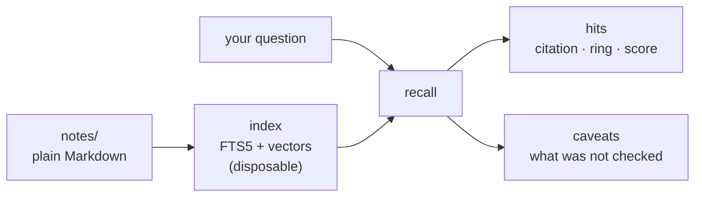

<div align="center">


# Cyberbrain

**Cited, trust-tiered, local-first memory for AI coding agents.**

[](https://github.com/bassprofressor-lab/cyberbrain/actions/workflows/ci.yml)
[](https://crates.io/crates/cyberbrain)
[](LICENSE.md)
[](rust-toolchain.toml)
[](#install)
[](#built-for-the-eu-switchable-off)

**English** · [Deutsch](README.de.md)

[Install](#install) · [Five minutes](#five-minutes) · [Features](#at-a-glance) ·
[How it works](#how-it-works) · [What it needs](#what-it-needs) ·
[Compliance](#built-for-the-eu-switchable-off) · [Changelog](CHANGELOG.md) · [Spec](docs/SPEC.md)

</div>

One native binary. Your notes stay plain Markdown you can read, edit and grep. Nothing
leaves the machine unless you say so, and every path that could is listed in one place you
can print.

<picture>
  <source media="(prefers-color-scheme: dark)" srcset="docs/images/notes-dark.png">
  
</picture>

<sub>The web page that ships inside the binary, here in German; it speaks English as well.
Screenshots are from a demo store, the notes in them are invented.</sub>

## New in 0.8

- **Speech to text, locally.** `cyberbrain transcribe <file>` turns a voice memo or a meeting
  into a note through a whisper.cpp server on your own machine, and the page gets a
  microphone button for dictation. [More below](#speech-to-text).
- **A signed audit log.** `policy audit-key --init` gives a store an Ed25519 key; every new
  row is signed, and `verify-export` checks an exported bundle against the fingerprint the
  recipient was given.
- **Decoys.** `cyberbrain canary plant` puts a credential nobody uses into a note. Any use of
  it outside that note is refused and recorded as `canary.hit`.
- **Tokens that expire**, for MCP clients, hub credentials and device tokens.
- **A new look.** A Windows 11 style web page, a neon brain as the icon, and a launcher and
  installer that speak German on a German Windows.
- Many fixes in sync, the governance fallback, PII redaction and file permissions:
  [CHANGELOG](CHANGELOG.md#080--2026-10-27), including what to watch for when upgrading.

## At a glance

| | |
|---|---|
| **Cited** | every hit carries an ID like `r2-867ef2a8cd01` that resolves to the exact source block |
| **Trust-tiered** | notes live in rings 0 to 4; the lower ring wins a contradiction, and the conflict is reported |
| **Local-first** | embeddings are computed on your machine; the core performs no network I/O |
| **Hybrid search** | SQLite FTS5 for the words and local vectors for the meaning, fused into one ranking |
| **Honest results** | every answer says what was *not* checked, as a caveat |
| **Four ways in** | command line, agent hooks, MCP server, web page with HTTP API |
| **Team hub, optional** | one machine collects the others' audit trail; note sharing only when switched on |
| **Compliance built in** | egress register, erasure, subject access, PII check, signed hash-chained audit log |

```console
$ cyberbrain recall 'postgres data directory'
1. r2-867ef2a8cd01  r2  pg18-moves-pgdata  (100% of top)
     # PostgreSQL 18 moves PGDATA
     The official `postgres:18` image puts the data directory at
     `/var/lib/postgresql/18/docker` instead of `/var/lib/postgresql/data` ...
caveat: contradiction check skipped: no inference model is configured
```

That last line is the point as much as the hit is. The tool says what it did **not** check.
The page does the same:

<picture>
  <source media="(prefers-color-scheme: dark)" srcset="docs/images/search-dark.png">
  
</picture>

## Install

```console
$ cargo install cyberbrain
$ cyberbrain init
```

Or take a binary from the [latest release](https://github.com/bassprofressor-lab/cyberbrain/releases/latest)
(Linux x86_64, Windows x86_64, macOS on Apple silicon) and check it against the
`SHA256SUMS` that ships beside it:

```console
$ sha256sum -c SHA256SUMS
$ ./cyberbrain-linux-x86_64 init
```

The binary needs nothing at runtime: no system SQLite, no OpenSSL, no model server, no node.

### Windows without a terminal

The release also carries `cyberbrain-setup-<version>.exe`. It installs the command-line tool
and a small launcher, and puts **Cyberbrain** in the Start menu. Clicking it asks once which
project to open, starts the server on a port Windows picks, opens the page, and sits in the
notification area until you quit it: right-click for the project folder, a different
project, *Start with Windows* (off by default), or Quit. Closing it stops the server. A
second start does not give you a second icon; it shows the page that is already running.
Launcher and installer speak German on a German Windows and English everywhere else.

It is not signed, so SmartScreen will warn on first run: More info, then Run anyway. The
installer puts `C:\Program Files\Cyberbrain` on the machine `PATH`, so `cyberbrain` works in
a fresh terminal too. It does that through a small PowerShell script rather than NSIS
itself, because NSIS truncates strings at a fixed length and a machine PATH is regularly
longer; reading it in the installer and writing it back would quietly cut off its end.

The same installer can set up [the hub](#team-the-hub) by ticking *Hub service (collector)*.

<details>
<summary>Without the web page, or from a checkout</summary>

<br>

The page is compiled into the binary and ships inside the crate, so the normal install needs
no node toolchain. Leave the page out if you would rather not carry it; the CLI, the hooks,
the MCP server and the HTTP API are unaffected, and `serve` answers the API while saying the
page was not built in:

```console
$ cargo install cyberbrain --no-default-features
```

From a checkout the page is not packaged, it is built, so build it first:

```console
$ git clone https://github.com/bassprofressor-lab/cyberbrain && cd cyberbrain
$ (cd ui && npm ci && npm run build)
$ cargo install --path crates/cyberbrain
```

</details>

## Five minutes

```console
$ cyberbrain init
$ cyberbrain write --ring 2 --kind bug --name pg18-moves-pgdata --body 'what you learned'
$ cyberbrain scan
$ cyberbrain recall 'what you learned'
```

Four ways in, all from the same binary:

| | |
|---|---|
| `cyberbrain <command>` | everything is reachable from the command line, `--json` on all of it |
| `cyberbrain hook <event>` | six agent lifecycle events; measured p99 of 4 ms including process start, against a 15 ms budget |
| `cyberbrain mcp` | Model Context Protocol over stdio, for any client that speaks it |
| `cyberbrain serve` | the web page and the HTTP API, on loopback, with no login because it never leaves the machine; on Linux only your own account (and root) can connect |

`cyberbrain install` switches the first two on without you editing anyone's JSON: it writes
the hooks into this project's Claude Code settings and an MCP entry into the desktop clients
it finds, keeps the previous file beside the new one, and `--undo` takes it all back out. It
writes every Claude Desktop installation it finds rather than the documented path, because on
Windows those are not the same file and the wrong one fails silently. An MCP entry of the
same name that does not start cyberbrain is reported as `not-ours` and left alone.

The page has a command line of its own, so `find`, `export` and everything else without a
screen do not mean leaving for a terminal. It runs the same binary that is serving the page,
against that page's store, and hands back the same stdout, stderr and exit code.

`cyberbrain serve --terminal` puts a real terminal in the page: a shell, `ssh`, an agent, in
the project's directory. It is off unless you ask for it, it needs a token the address
carries in its fragment, and it refuses a handshake from any other origin. The egress
register lists it as the one path this program does not mediate, because a register that
left it out while `ssh` is one keystroke away would be false.

Rings 0 and 1 are the operator's, and `cyberbrain propose` is how everyone else offers one:
the note goes to `proposals/`, outside the notes tree, so it is not indexed and `recall`
cannot return it. An unapproved invariant that an agent can retrieve is an invariant nobody
agreed to. Somebody other than the proposer accepts it with `cyberbrain review <name>
--accept`, the page shows a line diff when a proposal changes an existing note, and the
audit log names both people.

## How it works



Notes are the source of truth and stay yours: one Markdown file per note, in the repository,
readable without this tool. The index is derived and can be deleted at any time;
`cyberbrain scan` rebuilds it. Retrieval is lexical and semantic at once, SQLite FTS5 for
the words and a flat cosine scan over local embeddings for the meaning, fused into one
ranking. `recall --stand <date>` searches the store as it stood on that day.

### Three properties that keep a memory worth trusting

**Cited.** Every retrieved statement carries an identifier that resolves back to the exact
source block. `cyberbrain recall --id r2-867ef2a8cd01` expands it. An answer without a
citation is a bug, not a degraded result.

**Trust-tiered.** Notes live in numbered rings. Ring 0 holds operator invariants and
overrides everything; ring 4 is unverified material. Rings 0 and 1 are injected into every
session and are size-capped so that stays affordable. When two blocks contradict, the lower
ring wins and the conflict is reported rather than silently resolved.

**Local-first.** Embeddings are computed on your machine. The core performs no network I/O
at all. Optional local inference over any OpenAI-compatible endpoint: Ollama, LM Studio,
llama.cpp, or NVIDIA PAIR spreading the work across an RTX box, a DGX Spark and an Apple M4
Mac. That endpoint may sit on another machine in your own network, so one box with a GPU can
serve a whole team: [`docs/SHARED-INFERENCE.md`](docs/SHARED-INFERENCE.md).

### Speech to text

`cyberbrain transcribe <file>` sends a recording to a [whisper.cpp](https://github.com/ggml-org/whisper.cpp)
server on your own machine (`whisper-server --convert`) and writes the text the way `write`
does: PII check, audit row, index. Ring 3 by default, tagged `transcript`. `--segments` keeps
each stretch of speech with its time in the recording, `--print` only shows the text. In the
page, a microphone button beside the search field and the note editor puts dictated text
into the field; nothing is saved until you save it.

It is off until you name the server, and it is held to the same rule as inference: loopback
or a private range unless `[inference]` waives it, every call in the audit log. The default language is German; set
`language` to another whisper code or `auto`.

```toml
# cyberbrain.toml
[transcription]
base_url = "http://127.0.0.1:8178"
language = "en"
```

No C++ in this build: the model runs in its own process, as embeddings run in Ollama.

## Team: the hub

A hub is the one machine in a team that collects the others' audit trail. On Windows the
installer sets it up with one tick: it registers a service, opens the port, and makes a
folder for the licence file. On the client machines, *Connect to the company hub…* in the
tray menu takes the invitation file they were sent. The hub has a page at
`http://localhost:7788/` for licence, seats, people, fleet invitations and which machines
are reporting. The first visit from the hub's own machine sets the administrator password
(there is no default one); after that it opens from any desk, over HTTPS.

By default the hub takes audit rows and nothing else: a row says that a note was written,
never what it said. A team that wants the same handover note on four desks can switch note
sharing on, and then the hub does hold the text of the notes that carry a `bereich`. Never
rings 0 and 1, only for devices with a grant for that bereich, and only once a second person
has countersigned that grant, so that whoever runs the hub cannot point a department at a
machine of their own.

Credentials and device tokens can carry an end date (`--expires`). A hub can post what needs
a person (countersignatures waiting, a licence ending, devices quiet for 48 hours, a token
about to expire) to one webhook its administrator sets; that is off until a URL is given.
`cyberbrain policy egress` prints which of these paths are on, on your machine, without
asking anybody. [`docs/HUB.md`](docs/HUB.md) has the whole picture.

## What it needs

A laptop. There is no large model to host here: semantic search uses **static embeddings**,
which is a table lookup and an average rather than a forward pass through a network. That is
why one CPU core is enough, and why the artefact on disk is larger than the work it does:
what takes up the space is vocabulary, not computation.

| | without a model | with the embedding model |
|---|---|---|
| one search | 10 ms | 2.3 s, most of it loading the model |
| memory | 14 MB | 1.55 GB peak while the search runs |
| full re-index | 0.7 s | 4.0 s |
| on disk | — | 507 MB for the artefact |

<sub>Measured on 2026-09-06 against a real store of 1,004 notes and 4,031 blocks, on a server
with no GPU (AMD EPYC-Milan, 12 vCPU, 23 GB RAM). Your corpus will give other numbers; the
order of magnitude is the point.</sub>

No GPU, no model server, no account, no cloud, and no download without your consent. The
only part that wants better hardware is the optional contradiction check: it needs an
inference endpoint, and on that CPU-only server one check took 126 s, over the 3 s budget.
So the hits came back unchecked, and said so.

<picture>
  <source media="(prefers-color-scheme: dark)" srcset="docs/images/status-dark.png">
  
</picture>

<sub>The status screen: static embeddings loaded, the optional inference endpoint on a local
Ollama, `doctor` clean, two decoys planted and never touched.</sub>

### Semantic search needs a model, and it will tell you if it has none

Out of the box search is lexical, and every result says so in a caveat. Lexical means
literal: without a model, `postgres` does not find `PostgreSQL`, and the words you search
for are the words that have to be in the paragraph.

**Nothing is downloaded on your behalf, ever, and there is no command that would.** Turning
on semantic search is three steps and you do all three:

```console
$ # 1. put model.safetensors and tokenizer.json under <store>/models/model2vec
$ #    a model2vec artefact, for example minishlab/potion-multilingual-128M (~500 MB) or
$ #    the smaller potion-base-8M (~30 MB); both are MIT
$ cyberbrain manifest   # 2. records the blake3 digest of each, so a later swap is refused
$ cyberbrain scan       # 3. vectors are written when a note is indexed, not before
```

The digests are the point of the manifest: an artefact that does not match the one recorded
is refused rather than loaded, because a model swapped underneath a store changes what its
vectors mean without changing anything you can see.

### Better search for the price of a forward pass: a local Ollama

Static embeddings have no context and no word order. If the machine runs
[Ollama](https://ollama.com), a transformer embedding model behind it finds noticeably more:
on 34 questions over 1,800 German project notes, hybrid recall put the right note in the top
three for 79 % of them with potion-multilingual-128M and for 88 % with
`embeddinggemma:300m-qat-q4_0` (245 MB); in first place for 56 % against 71 %. The price is
about 20 ms per query instead of a few, and a full re-index takes minutes instead of seconds
(ten on the 12-vCPU server above).

```console
$ ollama pull embeddinggemma:300m-qat-q4_0   # you download it, as above
$ cyberbrain bench-embedding                 # measures what is installed on *this* machine
```

`bench-embedding` times every installed candidate on a sample of your own blocks, query
latency and rebuild time, and prints the `[embedding]` section for the one that fits,
including the digest of the weights Ollama loads. That digest plays the manifest's part: if
the weights behind the tag ever change, Cyberbrain refuses them instead of mixing their
vectors into the index. The request goes through the same register and audit log as every
inference call, and if Ollama does not answer, search falls back to lexical and says so.

## Built for the EU, switchable off

<picture>
  <source media="(prefers-color-scheme: dark)" srcset="docs/images/compliance-dark.png">
  
</picture>

<sub>The headline is computed from the egress register, not typed in. Traffic to your own
network and to a hub is counted separately beside it. Below, what the active profile claims
the law says, with the article each line rests on and how sure the author is of it.</sub>

Compliance is a subsystem, not a section in the docs. `cyberbrain policy egress` prints
every path by which bytes can leave the machine, what each carries, and whether it is on.
Today that list has nine entries, and it ends with "Telemetry does not exist."

- **Erasure that erases** (GDPR Art. 17): `cyberbrain forget` removes the note, its blocks,
  its vectors, its index rows and its derivatives in one transaction, and prints what went.
  `--report FILE --sign` writes an erasure report somebody else can check.
- **Subject access** (Art. 15): `cyberbrain policy subject <identifier>` returns everything
  stored about it, with citations.
- **A PII check before a note is written**, holding the write for your decision rather than
  redacting behind your back.
- **An append-only audit log** with a blake3 hash chain, and a `verify` that names the first
  altered row and exits non-zero. With an audit key every new row is also signed, so an export
  proves more than that it is self-consistent.
- **Decoys** that raise their hand: a planted credential used anywhere but its own note is
  refused, counted and recorded. The value itself never appears in the log or an alert.
- **Retention** per note, applied on request and never silently in the background.
- **An obligation catalogue**: `cyberbrain policy obligations` prints what the active profile
  claims the law requires, each line with its article and a confidence.

`policy.profile` is `eu`, `ch` or `off`. Switzerland is a separate profile rather than "EU
minus", because the revised FADP differs in substance and folding them together produces
claims that are wrong in one of the two countries. Nothing below high confidence drives
behaviour.

<details>
<summary>More of the web page (screenshots)</summary>

<br>

**In the team**: what would be shared and what stays on this machine. Without a hub it says
so, and notes without a bereich are never shared.

<picture>
  <source media="(prefers-color-scheme: dark)" srcset="docs/images/team-dark.png">
  
</picture>

**Graph**: notes and the links between them, by ring. A link to a note that does not exist
yet is drawn as intent rather than as an error. It works from the keyboard as well.

<picture>
  <source media="(prefers-color-scheme: dark)" srcset="docs/images/graph-dark.png">
  
</picture>

The page is compiled into the binary, speaks English and German, and fetches nothing from
the network.

</details>

## Status

**v0.8.1, and young.** 1,069 tests, 18 browser tests, seven crates on crates.io plus the
Windows launcher, clippy and rustfmt clean. Binaries for Linux, Windows and macOS (Apple
silicon) on the release page, and an installer beside them. It has been run against one
operator's real corpus, 1,086 notes across five projects, and not much else. Expect rough
edges, report them.

The Windows side is the newest part and the least worn in. It is no longer only compiled and
reviewed: CI installs the installer the way a customer would, silently, and then checks what
installing it did. That the hub made itself a certificate and recognises it as its own, that
the private key is unreadable by ordinary accounts, that the service registration carries the
certificate, and that uninstalling takes the service and the PATH entry away again and leaves
the record alone. That job exists because two faults reached an operator's desktop that no
amount of compiling would have shown. It has been installed and run on exactly one desktop
and one server. If it misbehaves on yours, that is worth an issue.

Cyberbrain is an original work. It shares no source code with any other memory tool; §0 of
[`docs/SPEC.md`](docs/SPEC.md) records the boundary it was built under, and the commit
history documents it decision by decision.

<details>
<summary>The seven crates</summary>

<br>

| crate | what it is |
|---|---|
| [`cyberbrain`](https://crates.io/crates/cyberbrain) | the binary: CLI, hooks, MCP server, HTTP API and the web page |
| [`cyberbrain-core`](https://crates.io/crates/cyberbrain-core) | store, notes, rings, config, the types everything else agrees on |
| [`cyberbrain-index`](https://crates.io/crates/cyberbrain-index) | the disposable index: FTS5, vectors, hybrid retrieval |
| [`cyberbrain-embed`](https://crates.io/crates/cyberbrain-embed) | static embeddings, loaded from a hash-verified artefact |
| [`cyberbrain-code`](https://crates.io/crates/cyberbrain-code) | the code index behind `cyberbrain find` |
| [`cyberbrain-llm`](https://crates.io/crates/cyberbrain-llm) | the optional OpenAI-compatible client |
| [`cyberbrain-policy`](https://crates.io/crates/cyberbrain-policy) | egress register, audit chain, PII gate, profiles, obligations |

</details>

## Contributing and security

[`CONTRIBUTING.md`](CONTRIBUTING.md) before the first pull request: the clean-room rule in
SPEC §0 binds contributors, and a contribution that breaks it breaks the provenance claim
above retroactively. Vulnerabilities go through [`SECURITY.md`](SECURITY.md), not a public
issue.

## Licence

[FSL-1.1-ALv2](LICENSE.md). Use it for anything except building a competing product, and
each release becomes Apache-2.0 two years after it ships. Copyright 2026 Krynex Labs.
