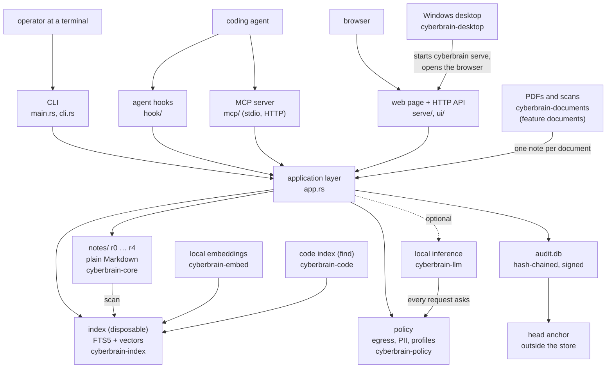
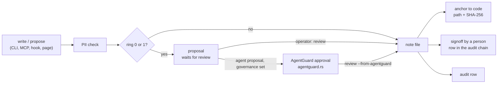
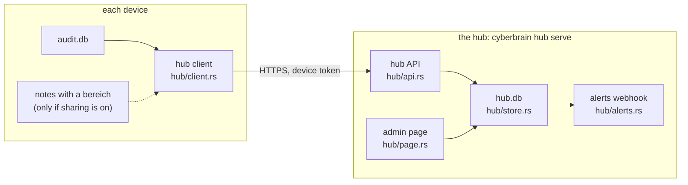

# Architecture

How the pieces fit together, from the outside in. The [README](../README.md) says what
Cyberbrain does; [`SPEC.md`](SPEC.md) says why each part is the way it is. This page is the
map between the two, so that a reader (or a tool that draws diagrams from repositories) does
not have to guess it from the file tree.

## One binary, four ways in

Everything a user or an agent touches is the one `cyberbrain` binary. The command line, the
agent hooks, the MCP server and the web page are thin adapters over the same application
layer (`crates/cyberbrain/src/app.rs`); none of them reaches the store on its own.

The rules that matter when reading the code:

- **Notes are the source of truth.** One Markdown file per note under `notes/r0` … `notes/r4`.
  The index is derived and `cyberbrain scan` rebuilds it from the notes at any time.
- **Rings decide trust.** Ring 0 holds operator invariants, ring 4 unverified material. Rings 0
  and 1 are injected into every session by the `SessionStart` hook and are size-capped. The
  lower ring wins a contradiction, and the conflict is reported as a caveat.
- **Who may write what is decided in the application layer**, not in the adapters. An agent,
  a hook, MCP or the page can write rings 2 to 4; rings 0 and 1 only through `propose`, which
  waits for a person (`review`). The process lineage (`lineage.rs`) makes an agent further up
  the process tree count as an agent here.
- **Nothing leaves the machine except through the egress gate** in `cyberbrain-policy`. Each
  purpose (model download, local inference, governance, hub enrolment, audit and note sync,
  note erasure, the remote terminal) is one entry in the register that
  `cyberbrain policy egress` prints, and each request is one audit row.

## What a note goes through

- **Anchors** (`app/anchoring.rs`): a note that names `path:line` keeps the file's hash;
  `recall` says when the code moved since.
- **Sign-off** (`app/signoff.rs`): a person at a terminal confirms a note; recall shows it until
  the text changes.
- **Canaries** (`canary.rs`): notes holding a credential nobody uses. Used in a tool call the
  pre-tool-use hook sees, or in any other note written or proposed, it is refused and recorded;
  with AgentGuard configured, `canary push` lets it watch the agents it governs as well.
- **Snapshot before compaction** (`hook/snapshot.rs`): the `PreCompact` hook keeps the
  conversation as a ring-3 note, and the next session is told its citation.

## Team: the hub is the same binary

A hub is not a second program. `cyberbrain hub serve` runs the hub from the same binary,
as a console server or, on Windows, as a service (`hub/service.rs` is only that service
wrapper).

- **What travels by default is the audit log, and nothing else.** The store's own audit log
  is the delivery buffer: the hub says where it stopped, the client sends the period since.
  A row says that a note was written, never what it said.
- **Note sharing is a switch.** When it is on, the hub holds the text of notes that carry a
  `bereich`, never rings 0 and 1, and only for devices with a grant for that bereich that a
  second person has countersigned. [`HUB.md`](HUB.md) has the whole picture.

## Crates

| crate | depends on | what it is |
|---|---|---|
| `cyberbrain` | all below | the binary: CLI, hooks, MCP, HTTP API, web page, hub, AgentGuard link |
| `cyberbrain-core` | nothing | store, notes, rings, citations, config, the shared types |
| `cyberbrain-index` | core | the disposable index: FTS5, vectors, hybrid retrieval, audit rows |
| `cyberbrain-embed` | core | static embeddings from a hash-verified artefact |
| `cyberbrain-code` | core | the code index behind `cyberbrain find` |
| `cyberbrain-llm` | core | the optional OpenAI-compatible client for local inference |
| `cyberbrain-policy` | core, llm | egress register, audit chain, PII gate, profiles, obligations |
| `cyberbrain-documents` | core | PDFs and scans into notes with page locators (feature `documents`) |
| `cyberbrain-desktop` | nothing | Windows Start-menu entry and tray icon; starts `cyberbrain serve` (not on crates.io) |

The web page is a separate build in `ui/` and ships inside the binary.
